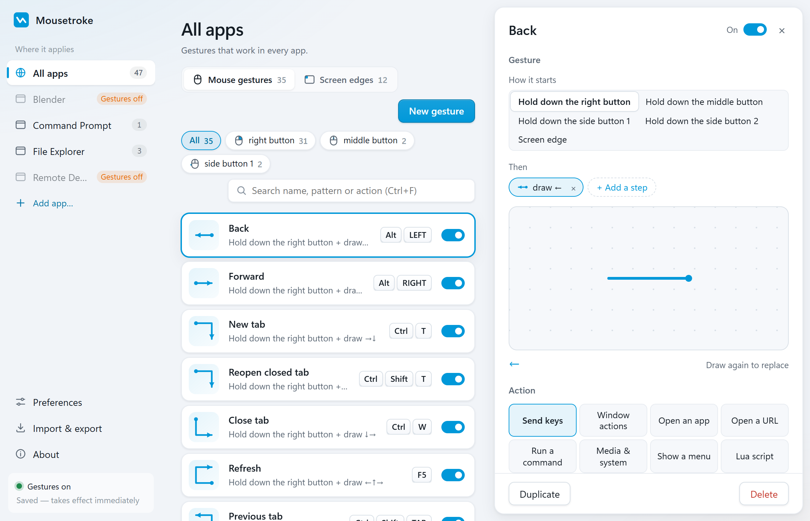

# Mousetroke

[](https://github.com/eiaao/mousetroke/actions/workflows/ci.yml) [](https://github.com/eiaao/mousetroke/releases/latest) [](LICENSE) 

**Free, open-source mouse gestures for Windows and macOS (beta).** Hold the right button and draw — `←` goes
back, `↓→` closes the tab, `↙` minimizes the window. Push the cursor into a screen corner for
the Start menu, or scroll along the top edge to change the volume. A plain right-click still
opens the context menu.

**[Website](https://mousetroke.pages.dev/) · [Download](https://github.com/eiaao/mousetroke/releases/latest) · [简体中文](README.zh-CN.md)**



- About 50 built-in gestures, all editable; record your own by drawing it once
- Screen corners and edges: Start menu, show desktop, volume, brightness (DDC/CI for external monitors)
- Eight action types: send keys, window actions, open an app, open a URL, run a command,
  media & system keys, popup menu, Lua script
- Per-app rules, or turn gestures off entirely in remote-desktop / 3D / design apps
- Pauses automatically for fullscreen games, video and presentations; `Win+Esc` pauses any time
- About 19 MB of memory; a single portable exe (≈13 MB); 10 interface languages

## Install

1. Download `mousetroke.exe` from the [latest release](https://github.com/eiaao/mousetroke/releases/latest) and check its
   SHA-256 against `SHA256SUMS.txt` on the same page.
2. Double-click it. An icon appears in the notification area: left-click for settings,
   right-click to pause or quit. A short guide runs the first time.

Requirements: Windows 10 1809+ or Windows 11, 64-bit. The settings window uses Microsoft Edge
WebView2 (built into Windows 11). The exe is not code-signed yet, so SmartScreen may warn on
first run — choose **More info → Run anyway**.

Uninstall: turn off *Start with Windows* in preferences, quit from the tray menu, then delete
`mousetroke.exe` and `%APPDATA%\mousetroke`.

## Build from source

Needs Rust (stable, MSVC toolchain), Node.js 20.19+ and Python 3, on Windows.

```bat
scripts\build.cmd            :: UI + release exe → dist\mousetroke.exe
cargo test --workspace       :: engine, importer, i18n and settings tests
```

| Path | What it is |
|---|---|
| `crates/mousetroke-core` | Platform-independent logic: config schema, recognizer, matcher, key-sequence syntax, built-in defaults, legacy-format importer |
| `crates/mousetroke-win` | Windows layer: low-level hooks, capture state machine, trail overlay, input injection, tray |
| `crates/mousetroke-settings` | Settings window (Tauri 2 + React); runs as a separate process only while open |
| `crates/mousetroke` | The `mousetroke.exe` entry point and CLI |
| `i18n/` | Shared UI strings for every language (see `i18n/README.md`) |
| `site/` | Product web page (static) |

## macOS beta

[Download Mac beta](https://github.com/eiaao/mousetroke/releases/latest/download/Mousetroke.dmg):
macOS 11+, Apple silicon and Intel in one universal app. Compare its SHA-256 with the
same release's `SHA256SUMS.txt` (which also lists the Windows exe).

1. Open the DMG, drag **Mousetroke** into **Applications**, then open it. If opened from the
   DMG, choose **Move to Applications** to install and reopen it there (or in `~/Applications`
   if the shared folder is not writable). Quit an older copy before replacing it.
2. The beta is self-signed and **not notarized**. If macOS blocks it, use **System Settings →
   Privacy & Security → Open Anyway**; on older macOS, **right-click → Open**. A newly
   downloaded update may need this step again.
3. Follow setup: each permission explains why it is needed and has a **Grant…** button.
   Allow **Accessibility** and **Input Monitoring**; setup shows **Ready**, then a short guide.
   Try holding the right button and drawing `←` in a window. You can skip and grant later
   from the menu bar. **Screen Recording is not required**.

The engine retries permissions every two seconds. If Input Monitoring still has not taken
effect after granting, setup offers **Restart Mousetroke**, keeping settings open.

About supports manual update checks, shared release notes and a **Download new version**
button that opens the DMG in your browser. Preferences controls the daily automatic check;
a new-version menu item opens About. Install the downloaded DMG in the same Applications folder.
Quit before replacing the app. Releases reuse one signing certificate to retain permissions;
changing the certificate or installation path can require granting them again.

Uninstall: quit from the menu bar, delete `Mousetroke.app`,
`~/Library/Application Support/mousetroke` and `~/Library/Logs/mousetroke`, then remove
Mousetroke from login items in System Settings.

See the [macOS guide](crates/mousetroke-mac/README.md) for build/sign/DMG commands,
release secrets, supported actions and the real-Mac acceptance checklist.

## Security

Shell and Lua actions run with your user rights — only import configurations you trust.
See [SECURITY.md](SECURITY.md) for what the program does and how to report a vulnerability.

## Contributing

Issues, translations and pull requests are welcome — see [CONTRIBUTING.md](CONTRIBUTING.md).

## License

[MIT](LICENSE)
