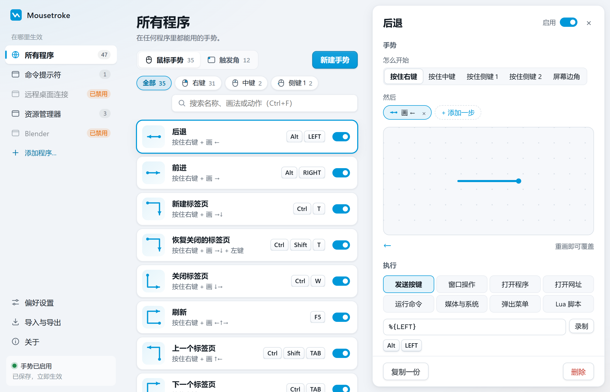

# Mousetroke

macOS 测试版提供 [通用 DMG](https://github.com/eiaao/mousetroke/releases/latest/download/Mousetroke.dmg)，支持 macOS 11+、Apple silicon 和 Intel。拖入“应用程序”并打开；从 DMG 打开时也可选择“移到应用程序”，安装后自动重新打开，共享目录不可写时改用 `~/Applications`。测试版未公证，如被拦截，到“系统设置 → 隐私与安全性 → 仍要打开”（旧系统右键 → 打开）。跟随设置引导，点击“授权…”开启辅助功能，让 Mousetroke 看见鼠标手势、操作窗口和发送快捷键；引擎事件 tap 启用后显示“准备就绪”，再试着按住右键画 `←`。也可以跳过，以后从菜单栏授权。引擎每两秒静默获取新鲜权限状态，运行中撤权也能检测；辅助功能开启几秒后仍无法监听或启用 tap，引导和菜单栏才显示输入监控兜底项，旧系统按提示开启即可。若授权后仍未生效，引导会自动重启一次，失败后提供“重启 Mousetroke”，保留设置窗口。无需屏幕录制权限。关于页“立即更新”会下载并验证 SHA-256、标识、版本和同一证书的签名要求，原地替换后自动重启，旧版在旧进程退出后移到废纸篓。替换或重启交接失败会回滚；应用内下载不带浏览器隔离属性，更新无需再次“仍要打开”，同一路径和签名要求用于保留权限。目录不可写或更新失败时可选择“手动下载”，浏览器下载的副本可能仍需“仍要打开”。偏好设置控制每日检查。

Mac 卸载：从菜单栏退出，删除应用、`~/Library/Application Support/mousetroke`、`~/Library/Logs/mousetroke`，并在系统设置中移除登录项。构建、签名与验收见 [Mac 指南](crates/mousetroke-mac/README.md)。

[](https://github.com/eiaao/mousetroke/actions/workflows/ci.yml) [](https://github.com/eiaao/mousetroke/releases/latest) [](LICENSE) 

**免费开源的 Windows 鼠标手势工具。** 按住右键画一笔：`←` 后退，`↓→` 关闭标签页，`↙` 最小化窗口。
鼠标推到屏幕左下角打开开始菜单，贴着上边滚动滚轮调音量。只是单击右键时，菜单照常弹出。

**[产品主页](https://mousetroke.pages.dev/) · [下载](https://github.com/eiaao/mousetroke/releases/latest) · [English](README.md)**

文档 / Documentation：[使用指南](docs/guide/zh-CN/index.md) · [User guide](docs/guide/en/index.md)



- 内置五十多个手势，全部可改；在设置里画一遍就能录一个自己的
- 屏幕边角：开始菜单、显示桌面、音量、亮度（外接显示器走 DDC/CI）
- 八种动作：发送按键、窗口操作、打开程序、打开网址、运行命令、媒体与系统、弹出菜单、Lua 脚本
- 按程序分别设置，或在远程桌面、3D、设计软件里整体禁用手势
- 全屏游戏、视频、演示时自动暂停；`Win+Esc` 随时暂停
- 常驻内存约 19 MB；单个 exe（约 13 MB）免安装；界面支持 10 种语言

## 安装

1. 从 [最新版本](https://github.com/eiaao/mousetroke/releases/latest) 下载 `mousetroke.exe`，并用同页的 `SHA256SUMS.txt` 核对校验值。
2. 双击运行。任务栏右下角出现图标：左键打开设置，右键暂停或退出。第一次运行有简短的使用引导。

系统要求：Windows 10 1809 及以上或 Windows 11，64 位。设置界面使用 Microsoft Edge WebView2（Windows 11 自带）。
exe 暂未做代码签名，首次运行时 SmartScreen 可能提示，点 **更多信息 → 仍要运行**。

卸载：在偏好设置里关掉开机自启，右键托盘图标选「退出」，再删除 `mousetroke.exe` 和 `%APPDATA%\mousetroke` 文件夹。

## 从源码构建

在 Windows 上需要 Rust（stable，MSVC 工具链）、Node.js 20.19+、Python 3。

```bat
scripts\build.cmd            :: 前端 + release exe → dist\mousetroke.exe
cargo test --workspace       :: 引擎、导入器、多语言与设置界面的测试
```

目录说明见 [README.md](README.md#build-from-source)。

[产品主页](https://mousetroke.pages.dev/) 在独立仓库中维护和部署。
网站更新日志从 raw.githubusercontent.com 读取本仓库 `main` 分支的 `CHANGELOG.md`。

## 安全

"运行命令"和 Lua 脚本拥有你的用户权限，只导入可信来源的配置。程序做了什么、怎么报告漏洞，见 [SECURITY.md](SECURITY.md)。

## 参与贡献

欢迎提问题、补翻译、提 PR，见 [CONTRIBUTING.md](CONTRIBUTING.md)。

## 许可证

[MIT](LICENSE)
